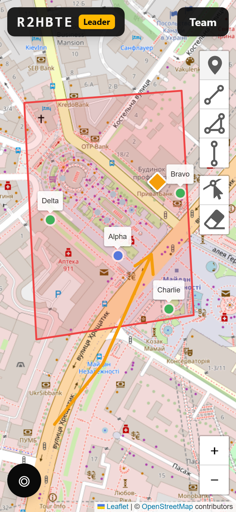
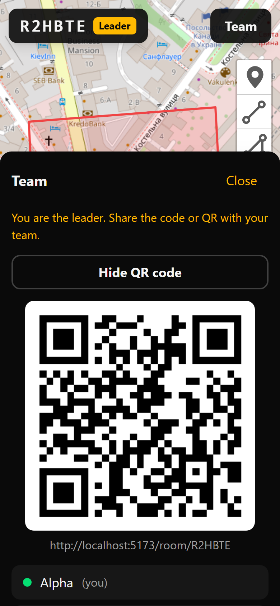
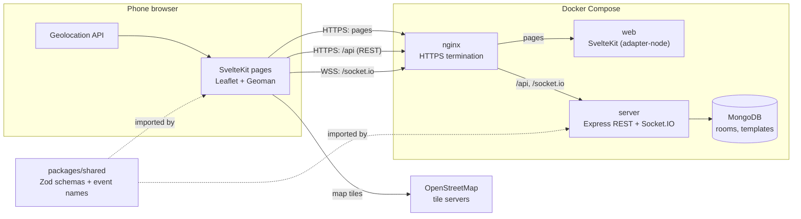
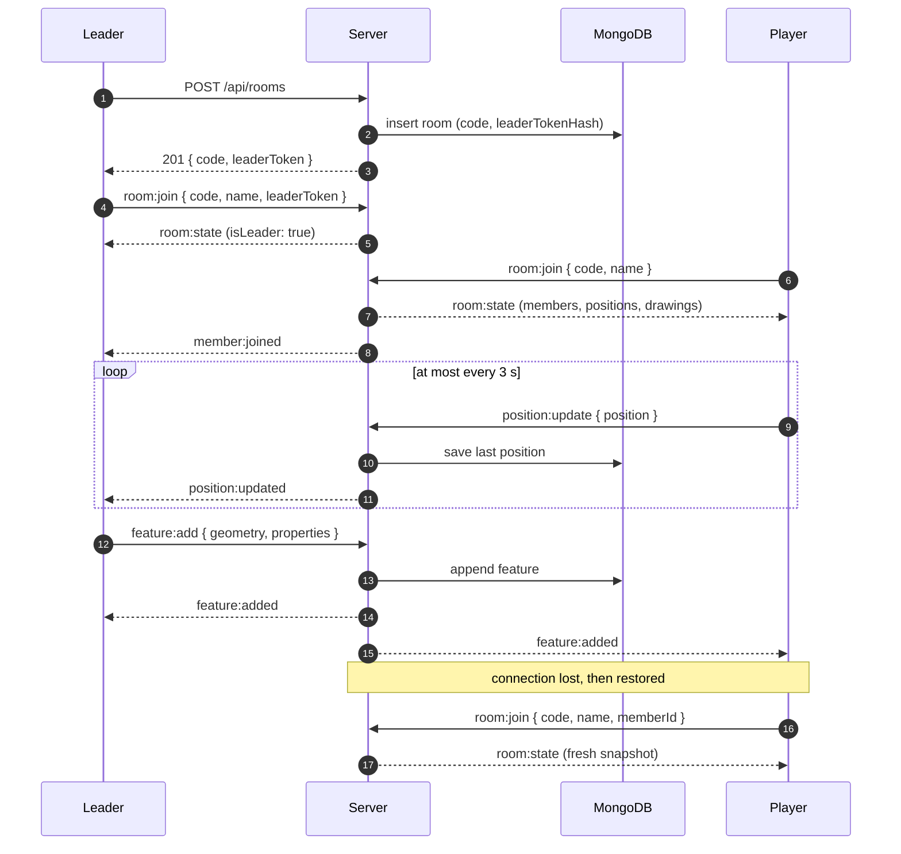

# Airsoft Tactical Map

Real-time tactical map for airsoft teams. The leader creates a room, players join by code or QR, everyone sees each other's live GPS positions, and the leader draws the game plan on the map. Zones and points of interest can be prepared as templates before game day.

SvelteKit, Leaflet, Node.js, Express, Socket.IO, MongoDB, Zod, Docker, nginx.

<p align="center">
  
  &nbsp;&nbsp;
  
</p>

## The problem

In a game, a team spreads out over a forest or a building site. Radio calls like "flank left of the big tree" don't scale, a paper map goes stale the moment people move, and the team leader has no idea where everyone actually is. Dedicated military-style apps need accounts, installs and setup that nobody does in a parking lot five minutes before the start.

This app is a web page: the leader creates a room, everyone scans a QR code, types a name and is on the map. No accounts, no install. It is built for a phone held in one hand, outdoors.

## Features

- **Rooms without accounts.** Anyone can create a room and becomes its leader. The room gets a 6-character join code without ambiguous characters (no `0/O`, `1/I/L`), and the leader's device keeps a secret leader token.
- **Join by code or QR.** Players type the code or scan the leader's QR code with the phone camera, then pick a display name. Reloads and reconnects resume the same member.
- **Live positions.** Each member shares browser GPS. Everyone sees everyone on the map with name labels, live members in green, dropped-out members greyed out at their last known position.
- **Leader drawing tools.** Markers, lines, arrows and zones (polygons); move, reshape and delete them. Changes reach every member instantly.
- **Server-enforced roles.** Only the leader's session can change drawings. Members don't get the toolbar, but the server rejects their drawing events either way.
- **Templates.** Outline the game zone and points of interest at home, save the template, load it into a room on game day.
- **Persistence.** Rooms and templates live in MongoDB. Anyone who (re)joins gets the current snapshot.
- **Built for the field.** Full-screen map, large touch targets, high contrast, a visible "Offline" state with automatic reconnect, clear banners for denied or missing GPS.
- **HTTPS deployment.** Docker Compose behind nginx with HTTPS, which browsers require for GPS.

## Architecture



- **One origin.** nginx serves pages, the REST API and the WebSocket under the same host, so there is no CORS. In development Vite proxies `/api` and `/socket.io` the same way.
- **Server is the source of truth.** Every socket payload and request body is parsed with a shared Zod schema before use. Invalid input gets an `error` back to that client only; nothing is broadcast and nothing crashes. Permissions come from the socket session (set at join from the leader token), never from the payload.
- **Clients render confirmed state only.** Even the leader's own drawing goes to the server and is drawn when `feature:added` comes back, so every screen shows the same thing.
- **GeoJSON everywhere.** Drawings are GeoJSON Features with `[lng, lat]` coordinates. Conversion to Leaflet's `[lat, lng]` happens in one file at the map boundary.

### Code organization: monorepo with vertical slices

```
apps/
  server/src/
    core/          socket server + validated handler, HTTP errors, config, secret hashing
    slices/
      rooms/       create room, join codes, leader token, join/leave, room snapshot
      presence/    live positions
      drawings/    feature add / update / delete, leader-only
      templates/   template REST CRUD, load template into a room
  web/src/
    lib/core/      socket client, Leaflet map setup, geolocation
    lib/slices/    the same four slices: stores and components
    routes/        thin pages that compose slices
packages/shared/   Zod schemas, inferred types and socket event names, used by both apps
e2e/               Playwright tests
infra/             Dockerfiles and nginx config
```

Code is grouped by feature, not by layer. Each slice owns its schemas, handlers, persistence, UI and tests, and other slices may only import its `index.ts`. Business rules (join codes, leader token checks, permission checks, throttling) are pure functions with unit tests that need no socket or database.

## Data flow



### Socket events

| Sent by | Event | Payload | What happens |
|---|---|---|---|
| Any client | `room:join` | `{ code, name, leaderToken?, memberId? }` | Server checks the room, resumes or creates the member, checks the leader token. Replies `room:state`, tells the others `member:joined`. Sent again on every reconnect. |
| Any member | `position:update` | `{ position: [lng, lat] }` | Saved as the member's last position, forwarded as `position:updated`. Clients send at most every 3 s (the newest fix always goes out), the server drops updates under 1 s apart. |
| Leader | `feature:add` | `{ geometry, properties: { kind } }` | Server assigns an id, appends it to the room, sends `feature:added` to the whole room. |
| Leader | `feature:update` | full Feature | Replaces the stored feature, sends `feature:updated` to the whole room. |
| Leader | `feature:delete` | `{ id }` | Removes it, sends `feature:deleted` to the whole room. |
| Leader | `template:load` | `{ templateId, ownerKey }` | Appends the template's drawings with fresh ids, one `feature:added` each. |
| Server | `room:state` | `{ code, memberId, isLeader, members, features }` | Full snapshot for the joining client. |
| Server | `member:joined` / `member:left` | member / `{ memberId }` | Someone joined or their last connection dropped. |
| Server | `error` | `{ event, message }` | Only to the client whose event failed (invalid payload, not the leader, room not found). |

Event names and payload schemas are defined once in [`packages/shared`](packages/shared/src) and imported by both apps.

### REST endpoints

| Method | Path | Notes |
|---|---|---|
| `POST` | `/api/rooms` | Creates a room. Returns the leader token, the only time it is ever sent. |
| `GET` | `/api/templates` | The caller's templates (summaries). |
| `POST` | `/api/templates` | Creates a template. |
| `GET` / `PUT` / `DELETE` | `/api/templates/:id` | Read, replace, delete. |

Template requests carry the device's owner key in the `x-owner-key` header. There are no accounts: templates belong to the device that created them.

### Security notes

- Leader tokens and template owner keys are 256-bit random values. The database stores only their SHA-256 hashes; leader tokens are compared in constant time.
- Join codes are checked for collisions by a unique index, so two rooms can never get the same code.
- Every write is a single atomic MongoDB update with its limits in the filter (e.g. max 500 drawings per room), so concurrent edits can't overshoot.
- Clients send room events only while joined. Socket.IO would otherwise queue events made offline and flush them before the rejoin, where the server would reject them.

## Run locally

Requirements: Node 24+, Docker, pnpm via corepack (`corepack enable`).

```bash
pnpm install
cp .env.example .env
pnpm dev            # MongoDB (docker compose) + server on :3000 + web on :5173
```

Open http://localhost:5173. Health check: http://localhost:5173/api/health. `localhost` counts as secure, so GPS works on desktop (Chrome DevTools > Sensors can fake a location).

| Command | What it does |
|---|---|
| `pnpm lint` | ESLint across the workspace |
| `pnpm typecheck` | `tsc` for server and shared, `svelte-check` for web |
| `pnpm test` | Vitest unit tests |
| `pnpm test:e2e` | Playwright end-to-end tests (first run: `pnpm exec playwright install chromium`) |
| `pnpm build` | Production build of the web app |

The server runs TypeScript directly on Node 24 (type stripping), so it has no build step.

## Run the full stack (HTTPS, like production)

```bash
docker compose up -d --build
```

Open https://localhost and accept the self-signed certificate warning. nginx terminates HTTPS and routes `/api` and `/socket.io` to the server and everything else to the SvelteKit app. The certificate is generated on first start and kept in the `certs` volume.

Run the e2e suite against this stack instead of the dev servers:

```bash
E2E_BASE_URL=https://localhost pnpm test:e2e
```

## Test on a phone

Browsers only allow GPS on HTTPS (or `localhost`), so a phone needs the HTTPS stack:

1. Find your computer's LAN IP (e.g. `192.168.1.50`) and put it in `.env`: `CERT_HOSTS=localhost,192.168.1.50`.
2. Recreate the certificate: `docker compose rm -sf nginx && docker volume rm airsoft-tactical-map_certs && docker compose up -d`.
3. On the phone (same Wi-Fi), open `https://192.168.1.50` and accept the certificate warning.
4. Allow your computer's firewall to accept inbound connections on port 443 if the page doesn't load.

To avoid the warning, mount a locally trusted certificate instead (e.g. made with [mkcert](https://github.com/FiloSottile/mkcert), with its root CA installed on the phone) as `fullchain.pem` and `privkey.pem` in the `certs` volume. In production, the same two files come from Let's Encrypt.

## Testing

- **Unit tests (Vitest)**, next to the code: join code generation, leader token checks, join and reconnect logic, the room snapshot, the validated socket handler, a permission matrix for every drawing and template event (leader, member, not joined, invalid payload), position flood guard and send throttle, template owner scoping, GeoJSON drawing schemas and arrowhead geometry.
- **End-to-end tests (Playwright)** on a Pixel 7 profile, with two or more browser contexts and mocked GPS: player joins by code and by QR, leader adds / moves / deletes drawings and players see it, live positions move on other screens, denied GPS, losing and regaining connection, templates prepared and loaded into a room, and REST API validation and owner scoping.

The e2e suite blocks OpenStreetMap tile requests, so it doesn't depend on the internet or load their servers.

## Roadmap

Next up (P1): GPS smoothing and movement-based sending, a member list with "last seen", undo and clear, automatic room expiry, CI on GitHub Actions, and a GraphQL API for templates (the REST routes already sit on a transport-agnostic service). Later: Prometheus metrics, MapLibre GL, offline map tiles, template export / import as GeoJSON, and teams inside a room.
